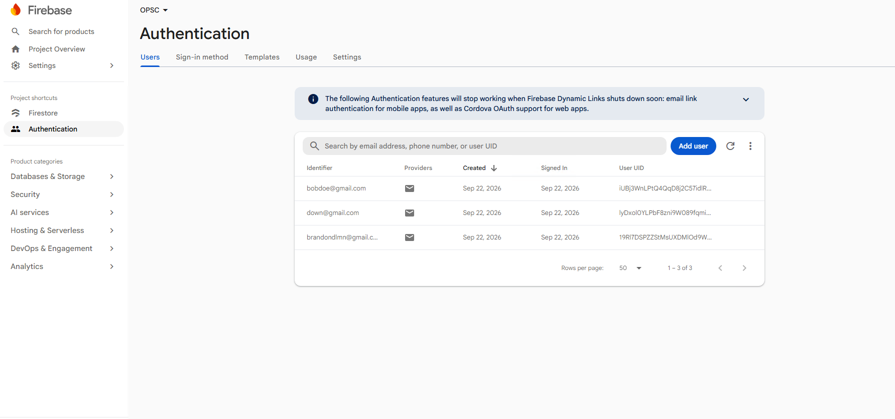

# EduConnect 🎓🚀

**Module:** OPSC6312 – Part 3:

**Group Members:**
- Kun'we Tyrone Mdaka (ST10262122)
- Oratile Maungwa (ST10443081)
- Gontse Rakosa (ST10449265)
- Richard Sebola (ST10441486)

**Repository:** [https://github.com/kunwe/EDU-CONNECT](https://github.com/kunwe/EDU-CONNECT)

---

## 📽️ Final Demonstration Video

Watch the final EduConnect POE demonstration to see the application's features and functionality in action.

[](https://youtu.be/gjg8ouS6haM)

[**Click here to watch the EduConnect Final POE Demonstration on YouTube**](https://youtu.be/gjg8ouS6haM)

---

## 📖 1. Purpose of the Application

**EduConnect** is an advanced Android educational application designed specifically to empower and assist **South African high school learners (Grades 8–12)** with career guidance, subject matching, matric requirement calculations, study summaries, interactive quizzes, and time management tools.

Powered by modern Android architectural practices, Firebase, and **Gemini AI**, the application helps learners connect their high school education with realistic and rewarding future career opportunities and tertiary education pathways.

EduConnect aims to address common educational challenges experienced by South African learners, including:

- Limited access to career guidance and educational resources.
- Language barriers that affect learning.
- Difficulty understanding university admission requirements.
- Limited access to reliable internet connectivity.
- Challenges with organising study schedules and managing examination preparation.

By addressing these challenges, EduConnect provides an inclusive educational platform that supports learners throughout their high school journey and helps them make informed decisions about their future.

---

## 🏗️ 2. Design Considerations & Architecture

The application was developed with scalability, maintainability, security, and user experience in mind. Modern Android development practices were followed to ensure the application remains organised and easy to maintain.

### 2.1 Architecture

- **MVVM (Model-View-ViewModel):** The application follows the MVVM architectural pattern, separating the user interface, business logic, and data management.
- **Repository Pattern:** Repositories manage data operations and provide a consistent way for ViewModels to access different data sources.
- **Dependency Injection:** Hilt (Dagger-Hilt) is used to manage dependencies and reduce tight coupling between application components.

### 2.2 User Interface & Experience

- **Jetpack Compose:** Used to build modern and responsive Android user interfaces.
- **Material Design 3:** Provides consistent design components and an improved user experience.
- **Input Validation:** The application handles invalid user inputs appropriately to reduce errors and prevent unexpected crashes.
- **Navigation:** Provides accessible navigation between the application's main features.

### 2.3 Security & Authentication

- **Firebase Authentication:** Handles secure user registration and email/password authentication.
- **Google Sign-In:** Implements Single Sign-On (SSO), allowing users to authenticate using their Google accounts.
- **Session Management:** Maintains user authentication sessions when the application is closed and reopened.

### 2.4 Data Storage & Persistence

- **Cloud Firestore:** Handles cloud-based NoSQL data storage, including user information, conversations, quiz results, and study summaries.
- **Firebase Storage:** Supports file and image storage, including profile images.
- **Room Database:** Provides local data persistence and caching for offline access.
- **Data Synchronisation:** Supports synchronisation between local and cloud data when an internet connection becomes available.

### 2.5 Networking & REST API Integration

- **Retrofit 2:** Handles communication with external REST APIs.
- **OkHttp 3:** Manages HTTP requests and network communication.
- **Google Gemini AI REST API:** Powers AI-generated study summaries, educational assistance, and career guidance.

---

## ✨ 3. Final Application Features

EduConnect combines educational tools, AI-powered assistance, and academic management features to provide learners with a complete learning experience.

### 3.1 🤖 AI-Powered Career Advisor

- Provides personalised career guidance based on the learner's grade and selected subjects.
- Uses the Gemini AI REST API to generate contextual responses.
- Provides information about APS scores, matric points, and university admission requirements.
- Supports guidance relating to South African universities, TVET Colleges, learnerships, and SETAs.
- Offers information about NSFAS and private bursary opportunities.
- Saves previous conversations using Cloud Firestore.

### 3.2 🔒 Secure Authentication & Google SSO

- Supports custom email and password registration.
- Provides Google Sign-In functionality.
- Uses Firebase Authentication to manage user accounts.
- Maintains persistent login sessions.
- Includes account validation to prevent unregistered accounts from logging in directly.

### 3.3 📝 Smart Quizzes & AI Summaries

- Provides CAPS-aligned interactive quizzes.
- Randomly selects questions to make quiz attempts more engaging.
- Records previous quiz attempts and scores.
- Generates AI-assisted revision notes and study summaries.
- Saves generated summaries for future reference.

### 3.4 📶 Offline Mode & Data Synchronisation

- Implements local caching using Room Database and Firestore persistence.
- Allows learners to access locally available study materials, timetables, and summaries without an internet connection.
- Maintains access to previously stored information during network interruptions.
- Synchronises supported data automatically when connectivity is restored.

### 3.5 🔔 Real-Time Push Notifications

- Integrates Firebase Cloud Messaging (FCM).
- Supports notifications for study reminders and important examination dates.
- Provides academic alerts and motivational notifications.
- Helps learners remain informed about upcoming academic activities.

### 3.6 🌍 Multilingual Support

- Supports English and isiZulu through Android string resource localisation (`strings.xml`).
- Allows learners to interact with the application using their preferred supported language.
- Improves accessibility for South African learners from different language backgrounds.

### 3.7 📅 Smart Timetable & Settings

- Allows learners to organise daily study periods.
- Helps manage examination dates and academic deadlines.
- Provides profile management and application settings.
- Supports different appearance preferences, including light and dark themes.

### 3.8 ⏱️ Study Time & Subject Tracker

- Tracks study hours for individual subjects.
- Provides weekly, monthly, and term-based study statistics.
- Displays progress graphs and study goals.
- Includes achievement badges to encourage consistent study habits.

### 3.9 📂 Internal Storage File Uploads

- Allows students and teachers to upload learning materials from their devices.
- Supports PDF documents, Word documents, text files, and images.
- Organises uploaded materials according to subjects and assignments.

---

## 🛠️ 4. Technology Stack

| Area | Technologies |
|---|---|
| Programming Language | Kotlin |
| UI Framework | Jetpack Compose, Material 3 |
| Architecture | MVVM |
| Dependency Injection | Hilt (Dagger-Hilt) |
| Networking | Retrofit 2, OkHttp 3 |
| AI Integration | Google Gemini AI REST API |
| Authentication | Firebase Authentication |
| Cloud Database | Cloud Firestore |
| Cloud File Storage | Firebase Storage |
| Local Database | Room Database |
| Asynchronous Programming | Kotlin Coroutines, LiveData and Flow |
| Push Notifications | Firebase Cloud Messaging (FCM) |
| Version Control | Git and GitHub |
| CI/CD | GitHub Actions |
| Testing | JUnit and Android unit testing |

---

## ⚙️ 5. Utilisation of GitHub & GitHub Actions

GitHub was used throughout the development process to manage the source code, track changes, and support collaboration between group members.

### 5.1 Version Control

- The project repository was created and maintained on GitHub.
- Code changes were committed regularly throughout development.
- Git was used to track modifications and maintain the project's development history.
- The final submission was tagged as `final POE`.

**GitHub Repository:** [EduConnect](https://github.com/kunwe/EDU-CONNECT)

### 5.2 GitHub Actions – CI/CD Pipeline

A Continuous Integration and Continuous Deployment (CI/CD) workflow was implemented using GitHub Actions.

Workflow location:

```text
.github/
└── workflows/
    └── android.yml
```

The workflow automates the following tasks:

1. Runs when changes are pushed or pull requests are submitted.
2. Sets up the required Java and Android development environment.
3. Builds the Android application.
4. Executes the configured unit tests.
5. Checks whether the Kotlin source code compiles successfully.
6. Reports build and testing results.

This automated process helps identify potential errors early and ensures that changes do not negatively affect the application's functionality.

### 5.3 Code Quality & Debugging

- Kotlin source code includes comments to explain important functionality.
- Logging statements such as `Log.d` and `Log.e` assist with debugging.
- Input validation helps prevent unexpected application behaviour.
- Application components are organised according to the MVVM architecture.

---

## 📱 6. Screenshots & Development Evidence

EduConnect provides a modern and learner-friendly interface designed to make studying, career planning, and managing academic activities easier.

### 6.1 Existing Part 2 Screenshots

The following screenshots demonstrate the application's original functionality and interface.

#### 🤖 AI Career Advisor

The AI Career Advisor helps learners explore career opportunities, university admission requirements, APS scores, and available bursaries.


#### 🏠 My Subjects

The My Subjects screen allows learners to view their selected school subjects, including languages, Mathematics, Life Orientation, Physical Sciences, Life Sciences, and Agricultural Sciences.


#### ⚙️ Settings

The Settings screen allows learners to manage their profiles, select their current academic term, change their passwords, and log out of the application.


#### 🔐 Firebase Authentication Evidence

The following screenshot demonstrates the Firebase Authentication configuration used by EduConnect.



#### 🤖 AI Quizzes

The AI Quizzes screen allows learners to access CAPS-aligned quizzes, test their subject knowledge, and review previous attempts through Quiz History.


---

### 6.2 New Part 3 POE Evidence

The Part 3 additions are documented in the architecture, feature, release notes, and AI usage sections below. The screen guide also includes the updated interface evidence for authentication, assignment management, notifications, study tracking, settings, and localisation. Add any further implementation-specific screenshots to this section when available.

---
# 📱 EduConnect App – Screen Guide

This section provides a visual walkthrough of the EduConnect mobile application, highlighting its main features and user workflows. The screenshots are organised into different sections to make it easier to understand the app's structure, functionality, and overall user experience.

## 1. Installation & Authentication

This section covers the initial application setup, user login, and the two-step student registration process.

### App Installation Screen
Shows the standard Android package installer, indicating that the application is being installed using an APK shared via WhatsApp. The installation screen also displays the **"No threats found"** security check.


### Login Screen
The main entry point for returning users. It includes:
- Email and Password input fields.
- A **Login** button.
- A **Sign in with Google** option for convenient authentication.
- A **Create an account** link for new users.


### Google Sign-In
Displays the standard Google authentication interface, allowing students to select or sign in using an existing Google account.


### Student Registration (Part 1 – Account & Personal Information)
The first stage of the registration process. Students can create an account using their email and password or Google authentication.

The form collects the following information:
- First Name
- Surname
- South African ID Number / Student Number
- Current Grade

### Student Registration (Part 2 – Subject Selection)
The second stage of registration allows students to select their academic subjects.

Students are required to choose:
- First Additional Language.
- Mathematics type (Pure Mathematics or Mathematical Literacy).
- Exactly three elective subjects from available categories, including Mathematics, Science and Technology (e.g., Physical Sciences, Information Technology and Engineering Graphics and Design).


---

## 2. Dashboard & Course Management

This section demonstrates the main dashboard and how students access and manage their enrolled subjects.

### EduConnect Dashboard
The home screen provides a personalised welcome message (e.g., **"Welcome, John"**) and displays the student's current grade.

It also lists all enrolled compulsory subjects, such as:
- English Home Language
- Afrikaans First Additional Language
- Mathematics
- Life Orientation

Students can quickly access their subjects directly from the dashboard.


### My Courses
Displays a comprehensive list of the student's active courses.

Each course card includes:
- Course name.
- Teacher's name.
- A visual progress bar showing the student's completion percentage.

For example, Mathematics 101 displays 75% course progress.

### Course Overview (Mathematics 101)
Provides detailed information about a selected course, including:
- Teacher information.
- Current student average (75%).
- Overview tab.
- Materials tab.
- Assignments tab.
- Grades tab.
- **Take Adaptive Quiz** button for self-assessment.

---

## 3. Assignment Management

This section demonstrates how students add, upload, and manage their academic assignments.

### Add Assignment Modal (Empty)
Displays the assignment submission form before any information has been entered.

The form includes:
- Assignment Title field.
- Due Date field.

### Add Assignment Modal (Filled)
Shows the assignment form after the student has entered the required information.

For example, the student enters **"Maths"** as the assignment title and selects a due date.

Students can also:
- Select files from their device's internal storage.
- Upload supported file formats, including TXT, PDF, Word documents and PNG images.
- Click the **Add** button to save the assignment.


---

## 4. Notifications & Calendar

This section highlights the application's notification system and integrated calendar functionality.

### Notifications Feed
Keeps students informed about important academic activities and upcoming events.

Notifications are organised into three categories:
- **All:** Displays all notifications.
- **Unread:** Shows notifications that have not yet been opened.
- **Announcements:** Displays important academic announcements.

Examples of notifications include:
- Upcoming assignment deadlines.
- Graded laboratory reports.
- Newly uploaded study materials.
- Class reminders.

### Notifications with Calendar
Shows the notification feed with the integrated calendar expanded.

The calendar displays a monthly view (e.g., November 2026), using dots to highlight dates with upcoming assignments, deadlines, or academic events.


---

## 5. Study Time & Subject Tracker

This section demonstrates EduConnect's study management and gamification features, helping students monitor their learning progress and maintain consistent study habits.

### Study Tracker (This Month)
Provides a monthly overview comparing the student's actual study time against their established study goals.

Progress bars display the time spent studying individual subjects, such as:
- Mathematics
- English
- Physical Sciences

### Study Tracker (This Week)
Displays study activity for the current week.

It helps students identify subjects that require additional attention. Visual indicators, such as orange warnings, highlight subjects where students are falling behind.

For example, History may display a **"Needs more study time"** notification.

### Study Tracker (This Term)
Provides an overview of study activity throughout the academic term.

It tracks the total hours spent studying against the student's term goals across all enrolled subjects.

### Overall Goal Adherence & Study Badges
Displays a summary of the student's overall study performance and goal completion.

For example, students may achieve an 85% study goal completion rate.

The section also includes **Study Badges & Milestones**, which reward students for their progress and consistency.

Examples include:
- 🏆 **Math Whiz:** Recognises strong performance in Mathematics.
- 🔥 **7-Day Streak:** Rewards students for maintaining a consistent study routine for seven consecutive days.
- 🎓 **Exam Ready:** Recognises preparation and progress towards examinations.


---

## 6. Settings & Localization

This section covers application customisation, accessibility options, language preferences, and account management.

### Settings Page (English)
The main settings menu allows students to customise their application experience.

Available settings include:
- **Language:** Change the application's display language.
- **Appearance:** Switch between Light and Dark themes.
- **Push Notifications:** Enable or disable notifications.
- **Account Management:** Access personal information, change passwords, and manage privacy settings.
- **Terms of Service:** View the application's terms and conditions.
- **Logout:** Securely sign out of the application.

### Language Selection Modal
Displays a pop-up menu where students can select their preferred application language.

Supported languages include:
- English
- isiZulu
- Afrikaans
- Sesotho


### Theme Selection Modals (Dark & Light)
Allows students to customise the application's appearance.

Available options include:
- **Light Mode:** Uses a bright interface.
- **Dark Mode:** Uses a darker interface for improved visual comfort in low-light environments.
- **System Default:** Automatically follows the device's appearance settings.


### Localized Settings (isiZulu & Afrikaans)
Demonstrates EduConnect's multilingual functionality by showing how the settings interface changes when a different language is selected.

Examples include:
- **isiZulu:** "Izilungiselelo"
- **Afrikaans:** "Instellings"

This feature improves accessibility and makes the application more inclusive for South African students from different language backgrounds.

---

## 📝 7. Release Notes – Version 2.0.0 (Final POE)

**Release Version:** 2.0.0  
**Release Type:** Final POE Submission  
**Module:** OPSC6312

Version 2.0.0 represents the final development stage of EduConnect. This release includes improvements and additional functionality introduced to meet the requirements of the Part 3 assessment.

### 7.1 New Features Added

**Real-Time Notifications**
- Integrated Firebase Cloud Messaging (FCM).
- Added support for study reminders and examination notifications.

**Offline Mode & Synchronisation**
- Implemented local database caching using Room Database.
- Improved access to previously stored timetables and study summaries without internet connectivity.
- Added automatic synchronisation when the device reconnects to the internet.

**Multilingual Support**
- Introduced isiZulu localisation alongside English.
- Added language resources using Android `strings.xml`.

### 7.2 Improvements & Fixes

- Improved handling of invalid user inputs to reduce unexpected crashes.
- Enhanced application stability and user experience.
- Added additional logging statements for debugging.
- Improved source code comments and organisation.
- Refined existing application functionality.

### 7.3 Publishing Preparation

- Generated a signed APK for application distribution.
- Prepared the application for Google Play Store publishing.
- Completed the final development and submission preparations.

---

## 🤖 8. AI Usage Declaration

During the development of EduConnect, artificial intelligence tools were used to support the learning, coding, debugging, and documentation processes.

The primary AI tools used were **ChatGPT** and **GitHub Copilot**.

### 8.1 Code Generation & Development Assistance

AI tools assisted with generating and understanding certain code structures, including:

- Boilerplate code for configuring Retrofit clients to communicate with the Google Gemini AI API.
- Assistance with implementing the MVVM architecture.
- Guidance on configuring dependency injection using Hilt.
- Suggestions for improving the organisation and structure of Kotlin classes.

### 8.2 Debugging & Troubleshooting

AI tools were used to help identify and understand technical issues encountered during development.

Examples include:

- Troubleshooting a NullPointerException involving Firestore data mapping.
- Understanding the correct configuration and placement of the `google-services.json` file.
- Identifying possible causes of application errors.
- Understanding Firebase integration and Android development concepts.

### 8.3 Documentation Assistance

AI tools also assisted with preparing and improving project documentation, including:

- Structuring and formatting the project README.
- Improving technical explanations.
- Preparing release notes.
- Organising descriptions of application features and architecture.

### 8.4 Responsible Use of AI

All AI-generated code and suggestions were reviewed, tested, and adapted to suit the specific requirements of the EduConnect application.

AI tools were used as development assistants rather than replacements for the group's own implementation, understanding, and decision-making.

Relevant AI assistance has been acknowledged in the project documentation and source code where applicable.

---

## 🤝 9. Contribution

Contributions, bug reports, and feature suggestions are welcome.

---

## 📄 10. License

This project is distributed under the **MIT License**.

---

## 👨‍💻 11. Development Team

**EduConnect Development Group – OPSC6312**

| Group Member | Student Number | Role |
|---|---|---|
| Kun'we Tyrone Mdaka | ST10262122 | Group Member |
| Oratile Maungwa | ST10443081 | Group Member |
| Gontse Rakosa | ST10449265 | Group Member |
| Richard Sebola | ST10441486 | Group Member |

**GitHub Repository:** [https://github.com/kunwe/EDU-CONNECT](https://github.com/kunwe/EDU-CONNECT)

---

<p align="center">
  <strong>EduConnect 🎓</strong>
  <br>
  <em>Connecting Education with Opportunity.</em>
  <br><br>
  Developed as part of the OPSC6312 Part 3 Final POE Submission.
</p>
